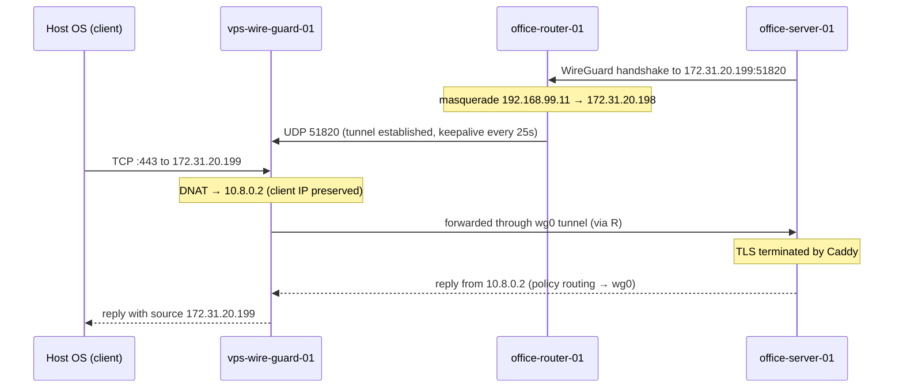

# 概要
WireGuard を使用して、外部からオフィスのサーバにアクセスするための構成例です。
これは、検証環境として、外部のVPSとオフィスのネットワークをエミュレートしたものです。
ここで構築するものは、全て仮想環境上(KVM)に構築し、実際の構成を模倣することを目的としています。

## Topology


図の中の`vps-wire-guard-01`, `office-router-01`, `office-server-01` をKVM で構築していきます。
`Host OS` は、KVM のホストOS で、環境をテストするためのクライアントとしても利用します。

## Packet flow



# 構築手順

## vps-wire-guard-01

### 前提

| 項目 | 値 |
|---|---|
| ISO | `/var/kvm/iso/alpine-virt-3.24.2-x86_64.iso` |
| ディスク格納先 | `/var/kvm/distros/vps-wire-guard-01/` |
| ディスク | `disk.qcow2` (qcow2, 4GB) |
| vCPU / メモリ | 1 / 512MB |
| NIC | `br0` (virtio) |

### 1. VM の作成 (Host OS)

VM 用のディレクトリとディスクイメージを作成します。

```sh
sudo mkdir /var/kvm/distros/vps-wire-guard-01
sudo qemu-img create -f qcow2 /var/kvm/distros/vps-wire-guard-01/disk.qcow2 4G
```

VM を作成します。シリアルコンソールに接続されるので、そのままインストールに進みます。

```sh
sudo virt-install \
  --connect qemu:///system \
  --name vps-wire-guard-01 \
  --memory 512 --vcpus 1 \
  --disk path=/var/kvm/distros/vps-wire-guard-01/disk.qcow2,format=qcow2,bus=virtio \
  --cdrom /var/kvm/iso/alpine-virt-3.24.2-x86_64.iso \
  --network bridge=br0,model=virtio \
  --osinfo alpinelinux3.24 \
  --graphics none --console pty,target_type=serial
```

### 2. Alpine Linux のインストール (ゲスト)

`root` (パスワードなし) でログインし、`setup-alpine` を実行します。

```sh
setup-alpine
```

主な入力値は以下の通りです。それ以外は環境に合わせて入力します。

| 項目 | 値 |
|---|---|
| Hostname | `vps-wire-guard-01` |
| Interface | `eth0` |
| IP address | `172.31.20.199/16` |
| Gateway | `172.31.0.1` |
| SSH server | `openssh` |
| Allow root ssh login | `prohibit-password` |
| ssh key for root | Host OS の公開鍵 |
| Disk | `vda` |
| How would you like to use it | `sys` |

インストール完了後、電源を切り、ディスクから起動し直します。

```sh
poweroff
```

```sh
sudo virsh start vps-wire-guard-01
sudo sh -c 'virsh dumpxml vps-wire-guard-01 > /var/kvm/distros/vps-wire-guard-01/domain.xml'
```

### 3. sshd のポート変更 (ゲスト)

22番ポートは `office-server-01` への転送に使用するため、sshd は 22222番ポートに変更します。

```sh
sed -i 's/^#\?Port .*/Port 22222/' /etc/ssh/sshd_config
rc-service sshd restart
```

以降は Host OS から以下で接続できます。

```sh
ssh -p 22222 root@172.31.20.199
```

### 4. パッケージのインストール (ゲスト)

```sh
apk add wireguard-tools nftables
```

### 5. IP フォワードの有効化 (ゲスト)

```sh
echo 'net.ipv4.ip_forward = 1' > /etc/sysctl.d/99-forward.conf
sysctl -p /etc/sysctl.d/99-forward.conf
rc-update add sysctl boot
```

### 6. WireGuard の設定 (ゲスト)

鍵ペアを作成します。

```sh
umask 077
wg genkey | tee /etc/wireguard/privatekey | wg pubkey > /etc/wireguard/publickey
```

`/etc/wireguard/wg0.conf` を作成します。`Endpoint` は指定しません(オフィス側から接続を開始するため)。

```ini
[Interface]
Address = 10.8.0.1/24
ListenPort = 51820
MTU = 1380
PrivateKey = <vps-wire-guard-01 の privatekey>
```

`[Peer]` は `office-server-01` の公開鍵が必要なため、`office-server-01` の構築後に追記します。

```ini
[Peer]
# office-server-01
PublicKey = <office-server-01 の publickey>
AllowedIPs = 10.8.0.2/32
```

起動時に `wg0` が立ち上がるようにします。

```sh
ln -s /etc/init.d/wg-quick /etc/init.d/wg-quick.wg0
rc-update add wg-quick.wg0 default
rc-service wg-quick.wg0 start
```

### 7. nftables の設定 (ゲスト)

`/etc/nftables.nft` を以下の内容に置き換えます。
`wg0` 側では masquerade を行わないため、`office-server-01` からはクライアントの IP アドレスがそのまま見えます。

```nft
#!/usr/sbin/nft -f

flush ruleset

table inet filter {
    chain input {
        type filter hook input priority filter; policy drop;
        ct state established,related accept
        ct state invalid drop
        iifname "lo" accept
        meta l4proto { icmp, ipv6-icmp } accept
        iifname "eth0" tcp dport 22222 accept
        iifname "eth0" udp dport 51820 accept
    }

    chain forward {
        type filter hook forward priority filter; policy drop;
        ct state established,related accept
        iifname "eth0" oifname "wg0" ip daddr 10.8.0.2 tcp dport { 22, 80, 443 } accept
    }
}

table ip nat {
    chain prerouting {
        type nat hook prerouting priority dstnat; policy accept;
        iifname "eth0" ip daddr 172.31.20.199 tcp dport { 22, 80, 443 } dnat to 10.8.0.2
    }
}
```

構文を確認してから有効化します。

```sh
nft -c -f /etc/nftables.nft
rc-update add nftables default
rc-service nftables start
```

### 8. 確認

ゲスト上で確認します。

```sh
wg show
nft list ruleset
sysctl net.ipv4.ip_forward
```

Host OS から sshd に接続できることを確認します。

```sh
ssh -p 22222 root@172.31.20.199
```

トンネルの疎通と DNAT (22, 80, 443) の確認は、`office-server-01` の構築後に行います。


