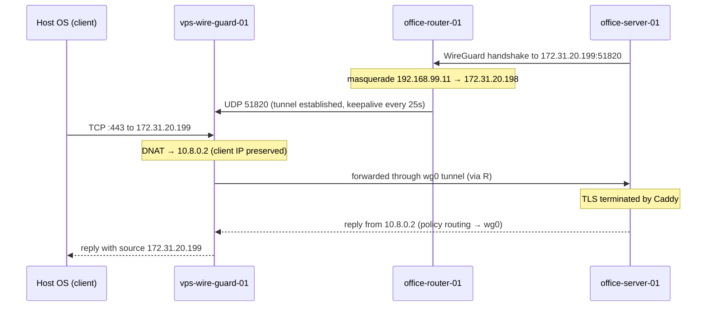

# 概要
WireGuard を使用して、外部からオフィスのサーバにアクセスするための構成例です。
これは、検証環境として、外部のVPSとオフィスのネットワークをエミュレートしたものです。
ここで構築するものは、全て仮想環境上(KVM)に構築し、実際の構成を模倣することを目的としています。

## Topology

図の中の`vps-wire-guard-01`, `office-router-01`, `office-server-01` をKVM で構築していきます。
`Host OS` は、KVM のホストOS で、環境をテストするためのクライアントとしても利用します。

## Packet flow

# 構築手順

