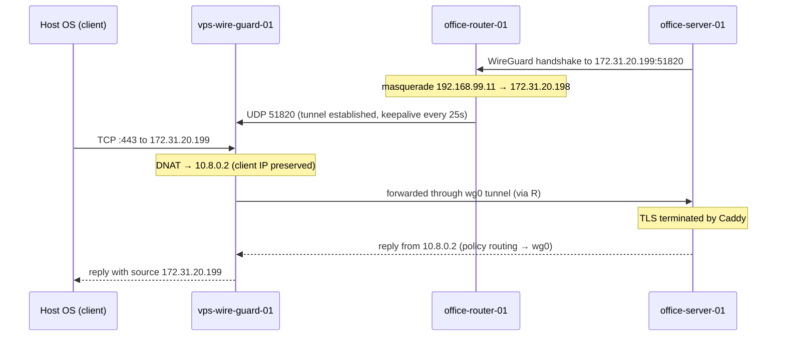

# 概要
WireGuard を使用して、外部からオフィスのサーバにアクセスするための構成例です。
これは、検証環境として、外部のVPSとオフィスのネットワークをエミュレートしたものです。
ここで構築するものは、全て仮想環境上(KVM)に構築し、実際の構成を模倣することを目的としています。

## Topology


図の中の`vps-wire-guard-01`, `office-router-01`, `office-server-01` をKVM で構築していきます。
`Host OS` は、KVM のホストOS で、環境をテストするためのクライアントとしても利用します。

## Packet flow



# 構築手順

## vps-wire-guard-01

### 前提

| 項目 | 値 |
|---|---|
| ISO | `/var/kvm/iso/alpine-virt-3.24.2-x86_64.iso` |
| ディスク格納先 | `/var/kvm/distros/vps-wire-guard-01/` |
| ディスク | `disk.qcow2` (qcow2, 4GB) |
| vCPU / メモリ | 1 / 512MB |
| NIC | `br0` (virtio) |

### 1. VM の作成 (Host OS)

VM 用のディレクトリとディスクイメージを作成します。

```sh
sudo mkdir /var/kvm/distros/vps-wire-guard-01
sudo qemu-img create -f qcow2 /var/kvm/distros/vps-wire-guard-01/disk.qcow2 4G
```

VM を作成します。シリアルコンソールに接続されるので、そのままインストールに進みます。

```sh
sudo virt-install \
  --connect qemu:///system \
  --name vps-wire-guard-01 \
  --memory 512 --vcpus 1 \
  --disk path=/var/kvm/distros/vps-wire-guard-01/disk.qcow2,format=qcow2,bus=virtio \
  --cdrom /var/kvm/iso/alpine-virt-3.24.2-x86_64.iso \
  --network bridge=br0,model=virtio \
  --osinfo alpinelinux3.24 \
  --graphics none --console pty,target_type=serial
```

### 2. Alpine Linux のインストール (ゲスト)

`root` (パスワードなし) でログインし、`setup-alpine` 用の answer file を作成します。
`ROOTSSHKEY` には Host OS の公開鍵 (`~/.ssh/id_ed25519.pub` の内容) を指定します。

```sh
cat > /tmp/answers <<'EOT'
KEYMAPOPTS=none
HOSTNAMEOPTS=vps-wire-guard-01
DEVDOPTS=mdev
INTERFACESOPTS="auto lo
iface lo inet loopback

auto eth0
iface eth0 inet static
    address 172.31.20.199/16
    gateway 172.31.0.1
"
DNSOPTS="172.31.0.1 8.8.8.8"
TIMEZONEOPTS="Asia/Tokyo"
PROXYOPTS=none
APKREPOSOPTS="-1"
USEROPTS=none
SSHDOPTS=openssh
ROOTSSHKEY="<Host OS の公開鍵>"
NTPOPTS=none
DISKOPTS="-m sys /dev/vda"
LBUOPTS=none
APKCACHEOPTS=none
EOT
```

answer file を指定してインストールします。

```sh
ERASE_DISKS=/dev/vda setup-alpine -e -f /tmp/answers
```

- `-e` は root のパスワードを空にします。SSH は公開鍵認証のみのため、影響するのはコンソールログインだけです。必要に応じて、インストール後に `passwd` で設定します。
- `ERASE_DISKS=/dev/vda` は、ディスク消去の確認を省略します。
- KVM ゲスト(kvm-clock)では、`setup-alpine` は NTP の設定をスキップします。NTP は手順 8 で設定します。

`Installation is complete. Please reboot.` と表示されたら電源を切り、ディスクから起動し直します。

```sh
poweroff
```

```sh
sudo virsh start vps-wire-guard-01
sudo sh -c 'virsh dumpxml vps-wire-guard-01 > /var/kvm/distros/vps-wire-guard-01/domain.xml'
```

Host OS から SSH で接続できることを確認します。以降のゲスト上の作業は SSH 経由で行えます。

```sh
ssh root@172.31.20.199
```

### 3. sshd のポート変更 (ゲスト)

22番ポートは `office-server-01` への転送に使用するため、sshd は 22222番ポートに変更します。

```sh
sed -i 's/^#\?Port .*/Port 22222/' /etc/ssh/sshd_config
rc-service sshd restart
```

以降は Host OS から以下で接続できます。

```sh
ssh -p 22222 root@172.31.20.199
```

### 4. パッケージのインストール (ゲスト)

```sh
apk add wireguard-tools nftables
```

### 5. IP フォワードの有効化 (ゲスト)

```sh
echo 'net.ipv4.ip_forward = 1' > /etc/sysctl.d/99-forward.conf
sysctl -p /etc/sysctl.d/99-forward.conf
rc-update add sysctl boot
```

### 6. WireGuard の設定 (ゲスト)

鍵ペアを作成します。

```sh
umask 077
wg genkey | tee /etc/wireguard/privatekey | wg pubkey > /etc/wireguard/publickey
```

`/etc/wireguard/wg0.conf` を作成します。`Endpoint` は指定しません(オフィス側から接続を開始するため)。

```ini
[Interface]
Address = 10.8.0.1/24
ListenPort = 51820
MTU = 1380
PrivateKey = <vps-wire-guard-01 の privatekey>
```

`[Peer]` は `office-server-01` の公開鍵が必要なため、`office-server-01` の構築後に追記します。

```ini
[Peer]
# office-server-01
PublicKey = <office-server-01 の publickey>
AllowedIPs = 10.8.0.2/32
```

起動時に `wg0` が立ち上がるようにします。

```sh
ln -s /etc/init.d/wg-quick /etc/init.d/wg-quick.wg0
rc-update add wg-quick.wg0 default
rc-service wg-quick.wg0 start
```

### 7. nftables の設定 (ゲスト)

Alpine の標準の `/etc/nftables.nft` は input / forward が `policy drop` で、SSH も許可されていません。
元のファイルを退避した上で、`/etc/nftables.nft` を以下の内容に置き換えます。

```sh
cp -p /etc/nftables.nft /etc/nftables.nft.orig
```

`wg0` 側では masquerade を行わないため、`office-server-01` からはクライアントの IP アドレスがそのまま見えます。

```nft
#!/usr/sbin/nft -f

flush ruleset

table inet filter {
    chain input {
        type filter hook input priority filter; policy drop;
        ct state established,related accept
        ct state invalid drop
        iifname "lo" accept
        meta l4proto { icmp, ipv6-icmp } accept
        iifname "eth0" tcp dport 22222 accept
        iifname "eth0" udp dport 51820 accept
    }

    chain forward {
        type filter hook forward priority filter; policy drop;
        ct state established,related accept
        iifname "eth0" oifname "wg0" ip daddr 10.8.0.2 tcp dport { 22, 80, 443 } accept
    }
}

table ip nat {
    chain prerouting {
        type nat hook prerouting priority dstnat; policy accept;
        iifname "eth0" ip daddr 172.31.20.199 tcp dport { 22, 80, 443 } dnat to 10.8.0.2
    }
}
```

構文を確認してから有効化します。

```sh
nft -c -f /etc/nftables.nft
rc-update add nftables default
rc-service nftables start
```

### 8. chrony の設定 (ゲスト)

```sh
setup-ntp chrony
```

### 9. 確認

再起動後も設定が有効であることを確認します。

```sh
reboot
```

ゲスト上で確認します。

```sh
wg show
ip addr show wg0
nft list ruleset
sysctl net.ipv4.ip_forward
rc-status default
chronyc tracking
```

- `wg0` が `10.8.0.1/24`, MTU 1380, listening port 51820 で起動していること
- `rc-status default` で `sshd`, `nftables`, `wg-quick.wg0`, `chronyd` が `started` であること

Host OS から sshd に接続できることを確認します。

```sh
ssh -p 22222 root@172.31.20.199
```

`office-server-01` の `[Peer]` に設定する公開鍵は、以下で確認できます。

```sh
cat /etc/wireguard/publickey
```

トンネルの疎通と DNAT (22, 80, 443) の確認は、`office-server-01` の構築後に行います。
それまでは、Host OS から `172.31.20.199` の 22, 80, 443 番ポートへの接続は `No route to host` になります。

### 10. スナップショットの取得 (Host OS)

`office-server-01` を `[Peer]` に追加する前の状態を、スナップショットとして保存します。
VM を停止してから取得します。

```sh
sudo virsh shutdown vps-wire-guard-01
sudo virsh domstate vps-wire-guard-01
```

`shut off` になったことを確認してから、スナップショットを取得します。
スナップショットは `disk.qcow2` の内部に保存されます(内部スナップショット)。

```sh
sudo virsh snapshot-create-as vps-wire-guard-01 base-configured \
  --description "Alpine 3.24.2 installed; sshd :22222, wg0 10.8.0.1/24 (no peer), nftables DNAT 22/80/443 -> 10.8.0.2, chrony. Before office-server-01 peer is added." \
  --atomic
sudo virsh snapshot-list vps-wire-guard-01
```

VM を起動し直します。

```sh
sudo virsh start vps-wire-guard-01
```

### 11. スナップショットへの復元 (Host OS)

手順 10 で取得した時点の状態に戻す場合の手順です。
スナップショット取得後にディスクへ加えた変更は、すべて失われます。

取得済みのスナップショットを確認します。

```sh
sudo virsh snapshot-list vps-wire-guard-01
sudo virsh snapshot-info vps-wire-guard-01 base-configured
```

VM を停止してから、スナップショットに戻します。

```sh
sudo virsh shutdown vps-wire-guard-01
sudo virsh domstate vps-wire-guard-01
```

```sh
sudo virsh snapshot-revert vps-wire-guard-01 base-configured
```

`base-configured` は停止状態で取得しているため、復元後の VM は `shut off` のままです。起動し直します。

```sh
sudo virsh start vps-wire-guard-01
```

復元後の状態を確認します。`wg show` に `[Peer]` が表示されないことを確認します。

```sh
ssh -p 22222 root@172.31.20.199 'wg show; rc-status default'
```
