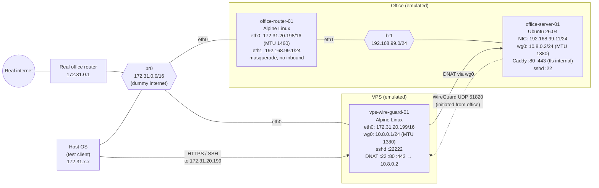
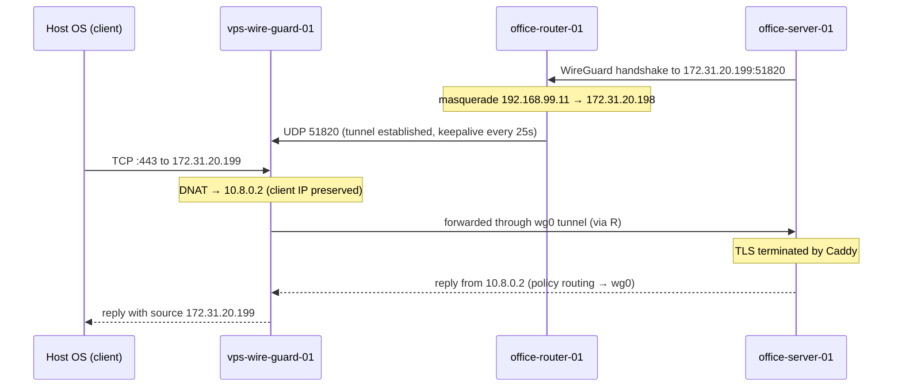

# 概要
WireGuard を使用して、外部からオフィスのサーバにアクセスするための構成例です。
これは、検証環境として、外部のVPSとオフィスのネットワークをエミュレートしたものです。
ここで構築するものは、全て仮想環境上(KVM)に構築し、実際の構成を模倣することを目的としています。

## Topology



図の中の`vps-wire-guard-01`, `office-router-01`, `office-server-01` をKVM で構築していきます。
`Host OS` は、KVM のホストOS で、環境をテストするためのクライアントとしても利用します。

## Packet flow



# 構築手順

## vps-wire-guard-01

### 前提

| 項目 | 値 |
|---|---|
| ISO | `/var/kvm/iso/alpine-virt-3.24.2-x86_64.iso` |
| ディスク格納先 | `/var/kvm/distros/vps-wire-guard-01/` |
| ディスク | `disk.qcow2` (qcow2, 4GB) |
| vCPU / メモリ | 1 / 512MB |
| NIC | `br0` (virtio) |

### 1. VM の作成 (Host OS)

VM 用のディレクトリとディスクイメージを作成します。

```sh
sudo mkdir /var/kvm/distros/vps-wire-guard-01
sudo qemu-img create -f qcow2 /var/kvm/distros/vps-wire-guard-01/disk.qcow2 4G
```

VM を作成します。シリアルコンソールに接続されるので、そのままインストールに進みます。

```sh
sudo virt-install \
  --connect qemu:///system \
  --name vps-wire-guard-01 \
  --memory 512 --vcpus 1 \
  --disk path=/var/kvm/distros/vps-wire-guard-01/disk.qcow2,format=qcow2,bus=virtio \
  --cdrom /var/kvm/iso/alpine-virt-3.24.2-x86_64.iso \
  --network bridge=br0,model=virtio \
  --osinfo alpinelinux3.24 \
  --graphics none --console pty,target_type=serial
```

### 2. Alpine Linux のインストール (ゲスト)

`root` (パスワードなし) でログインし、`setup-alpine` 用の answer file を作成します。
`ROOTSSHKEY` には Host OS の公開鍵 (`~/.ssh/id_ed25519.pub` の内容) を指定します。

```sh
cat > /tmp/answers <<'EOT'
KEYMAPOPTS=none
HOSTNAMEOPTS=vps-wire-guard-01
DEVDOPTS=mdev
INTERFACESOPTS="auto lo
iface lo inet loopback

auto eth0
iface eth0 inet static
    address 172.31.20.199/16
    gateway 172.31.0.1
"
DNSOPTS="172.31.0.1 8.8.8.8"
TIMEZONEOPTS="Asia/Tokyo"
PROXYOPTS=none
APKREPOSOPTS="-1"
USEROPTS=none
SSHDOPTS=openssh
ROOTSSHKEY="<Host OS の公開鍵>"
NTPOPTS=none
DISKOPTS="-m sys /dev/vda"
LBUOPTS=none
APKCACHEOPTS=none
EOT
```

answer file を指定してインストールします。

```sh
ERASE_DISKS=/dev/vda setup-alpine -e -f /tmp/answers
```

- `-e` は root のパスワードを空にします。SSH は公開鍵認証のみのため、影響するのはコンソールログインだけです。必要に応じて、インストール後に `passwd` で設定します。
- `ERASE_DISKS=/dev/vda` は、ディスク消去の確認を省略します。
- KVM ゲスト(kvm-clock)では、`setup-alpine` は NTP の設定をスキップします。NTP は手順 8 で設定します。

`Installation is complete. Please reboot.` と表示されたら電源を切り、ディスクから起動し直します。

```sh
poweroff
```

```sh
sudo virsh start vps-wire-guard-01
sudo sh -c 'virsh dumpxml vps-wire-guard-01 > /var/kvm/distros/vps-wire-guard-01/domain.xml'
```

Host OS から SSH で接続できることを確認します。以降のゲスト上の作業は SSH 経由で行えます。

```sh
ssh root@172.31.20.199
```

### 3. sshd のポート変更 (ゲスト)

22番ポートは `office-server-01` への転送に使用するため、sshd は 22222番ポートに変更します。

```sh
sed -i 's/^#\?Port .*/Port 22222/' /etc/ssh/sshd_config
rc-service sshd restart
```

以降は Host OS から以下で接続できます。

```sh
ssh -p 22222 root@172.31.20.199
```

### 4. パッケージのインストール (ゲスト)

```sh
apk add wireguard-tools nftables
```

### 5. IP フォワードの有効化 (ゲスト)

```sh
echo 'net.ipv4.ip_forward = 1' > /etc/sysctl.d/99-forward.conf
sysctl -p /etc/sysctl.d/99-forward.conf
rc-update add sysctl boot
```

### 6. WireGuard の設定 (ゲスト)

鍵ペアを作成します。

```sh
umask 077
wg genkey | tee /etc/wireguard/privatekey | wg pubkey > /etc/wireguard/publickey
```

`/etc/wireguard/wg0.conf` を作成します。`Endpoint` は指定しません(オフィス側から接続を開始するため)。

```ini
[Interface]
Address = 10.8.0.1/24
ListenPort = 51820
MTU = 1380
PrivateKey = <vps-wire-guard-01 の privatekey>
```

`[Peer]` は `office-server-01` の公開鍵が必要なため、`office-server-01` の構築後に追記します。

```ini
[Peer]
# office-server-01
PublicKey = <office-server-01 の publickey>
AllowedIPs = 10.8.0.2/32
```

起動時に `wg0` が立ち上がるようにします。

```sh
ln -s /etc/init.d/wg-quick /etc/init.d/wg-quick.wg0
rc-update add wg-quick.wg0 default
rc-service wg-quick.wg0 start
```

### 7. nftables の設定 (ゲスト)

Alpine の標準の `/etc/nftables.nft` は input / forward が `policy drop` で、SSH も許可されていません。
元のファイルを退避した上で、`/etc/nftables.nft` を以下の内容に置き換えます。

```sh
cp -p /etc/nftables.nft /etc/nftables.nft.orig
```

`wg0` 側では masquerade を行わないため、`office-server-01` からはクライアントの IP アドレスがそのまま見えます。

```nft
#!/usr/sbin/nft -f

flush ruleset

table inet filter {
    chain input {
        type filter hook input priority filter; policy drop;
        ct state established,related accept
        ct state invalid drop
        iifname "lo" accept
        meta l4proto { icmp, ipv6-icmp } accept
        iifname "eth0" tcp dport 22222 accept
        iifname "eth0" udp dport 51820 accept
    }

    chain forward {
        type filter hook forward priority filter; policy drop;
        ct state established,related accept
        iifname "eth0" oifname "wg0" ip daddr 10.8.0.2 tcp dport { 22, 80, 443 } accept
    }
}

table ip nat {
    chain prerouting {
        type nat hook prerouting priority dstnat; policy accept;
        iifname "eth0" ip daddr 172.31.20.199 tcp dport { 22, 80, 443 } dnat to 10.8.0.2
    }
}
```

構文を確認してから有効化します。

```sh
nft -c -f /etc/nftables.nft
rc-update add nftables default
rc-service nftables start
```

### 8. chrony の設定 (ゲスト)

```sh
setup-ntp chrony
```

### 9. 確認

再起動後も設定が有効であることを確認します。

```sh
reboot
```

ゲスト上で確認します。

```sh
wg show
ip addr show wg0
nft list ruleset
sysctl net.ipv4.ip_forward
rc-status default
chronyc tracking
```

- `wg0` が `10.8.0.1/24`, MTU 1380, listening port 51820 で起動していること
- `rc-status default` で `sshd`, `nftables`, `wg-quick.wg0`, `chronyd` が `started` であること

Host OS から sshd に接続できることを確認します。

```sh
ssh -p 22222 root@172.31.20.199
```

`office-server-01` の `[Peer]` に設定する公開鍵は、以下で確認できます。

```sh
cat /etc/wireguard/publickey
```

トンネルの疎通と DNAT (22, 80, 443) の確認は、`office-server-01` の構築後に行います。
それまでは、Host OS から `172.31.20.199` の 22, 80, 443 番ポートへの接続は `No route to host` になります。

### 10. スナップショットの取得 (Host OS)

`office-server-01` を `[Peer]` に追加する前の状態を、スナップショットとして保存します。
VM を停止してから取得します。

```sh
sudo virsh shutdown vps-wire-guard-01
sudo virsh domstate vps-wire-guard-01
```

`shut off` になったことを確認してから、スナップショットを取得します。
スナップショットは `disk.qcow2` の内部に保存されます(内部スナップショット)。

```sh
sudo virsh snapshot-create-as vps-wire-guard-01 base-configured \
  --description "Alpine 3.24.2 installed; sshd :22222, wg0 10.8.0.1/24 (no peer), nftables DNAT 22/80/443 -> 10.8.0.2, chrony. Before office-server-01 peer is added." \
  --atomic
sudo virsh snapshot-list vps-wire-guard-01
```

VM を起動し直します。

```sh
sudo virsh start vps-wire-guard-01
```

### 11. スナップショットへの復元 (Host OS)

手順 10 で取得した時点の状態に戻す場合の手順です。
スナップショット取得後にディスクへ加えた変更は、すべて失われます。

取得済みのスナップショットを確認します。

```sh
sudo virsh snapshot-list vps-wire-guard-01
sudo virsh snapshot-info vps-wire-guard-01 base-configured
```

VM を停止してから、スナップショットに戻します。

```sh
sudo virsh shutdown vps-wire-guard-01
sudo virsh domstate vps-wire-guard-01
```

```sh
sudo virsh snapshot-revert vps-wire-guard-01 base-configured
```

`base-configured` は停止状態で取得しているため、復元後の VM は `shut off` のままです。起動し直します。

```sh
sudo virsh start vps-wire-guard-01
```

復元後の状態を確認します。`wg show` に `[Peer]` が表示されないことを確認します。

```sh
ssh -p 22222 root@172.31.20.199 'wg show; rc-status default'
```

## office-router-01

オフィスのルータをエミュレートします。
`eth1` (オフィス LAN) から `eth0` (ダミーインターネット) への通信を masquerade し、外部からオフィス LAN への通信は転送しません。

### 前提

| 項目 | 値 |
|---|---|
| ISO | `/var/kvm/iso/alpine-virt-3.24.2-x86_64.iso` |
| ディスク格納先 | `/var/kvm/distros/office-router-01/` |
| ディスク | `disk.qcow2` (qcow2, 4GB) |
| vCPU / メモリ | 1 / 512MB |
| NIC 1 (`eth0`) | `br0` (virtio), `172.31.20.198/16`, MTU 1460 |
| NIC 2 (`eth1`) | `br1` (virtio), `192.168.99.1/24` |

### 1. VM の作成 (Host OS)

VM 用のディレクトリとディスクイメージを作成します。

```sh
sudo mkdir /var/kvm/distros/office-router-01
sudo qemu-img create -f qcow2 /var/kvm/distros/office-router-01/disk.qcow2 4G
```

VM を作成します。1つ目の `--network` が `eth0`、2つ目が `eth1` になります。

```sh
sudo virt-install \
  --connect qemu:///system \
  --name office-router-01 \
  --memory 512 --vcpus 1 \
  --disk path=/var/kvm/distros/office-router-01/disk.qcow2,format=qcow2,bus=virtio \
  --cdrom /var/kvm/iso/alpine-virt-3.24.2-x86_64.iso \
  --network bridge=br0,model=virtio \
  --network bridge=br1,model=virtio \
  --osinfo alpinelinux3.24 \
  --graphics none --console pty,target_type=serial
```

### 2. Alpine Linux のインストール (ゲスト)

`root` (パスワードなし) でログインし、`setup-alpine` 用の answer file を作成します。
`ROOTSSHKEY` には Host OS の公開鍵 (`~/.ssh/id_ed25519.pub` の内容) を指定します。

```sh
cat > /tmp/answers <<'EOT'
KEYMAPOPTS=none
HOSTNAMEOPTS=office-router-01
DEVDOPTS=mdev
INTERFACESOPTS="auto lo
iface lo inet loopback

auto eth0
iface eth0 inet static
    address 172.31.20.198/16
    gateway 172.31.0.1
    mtu 1460

auto eth1
iface eth1 inet static
    address 192.168.99.1/24
"
DNSOPTS="172.31.0.1 8.8.8.8"
TIMEZONEOPTS="Asia/Tokyo"
PROXYOPTS=none
APKREPOSOPTS="-1"
USEROPTS=none
SSHDOPTS=openssh
ROOTSSHKEY="<Host OS の公開鍵>"
NTPOPTS=none
DISKOPTS="-m sys /dev/vda"
LBUOPTS=none
APKCACHEOPTS=none
EOT
```

answer file を指定してインストールします。オプションの意味は `vps-wire-guard-01` の手順 2 と同じです。

```sh
ERASE_DISKS=/dev/vda setup-alpine -e -f /tmp/answers
```

`Installation is complete. Please reboot.` と表示されたら電源を切り、ディスクから起動し直します。

```sh
poweroff
```

```sh
sudo virsh start office-router-01
sudo sh -c 'virsh dumpxml office-router-01 > /var/kvm/distros/office-router-01/domain.xml'
```

Host OS から SSH で接続できることを確認します。以降のゲスト上の作業は SSH 経由で行えます。

```sh
ssh root@172.31.20.198
```

### 3. パッケージのインストール (ゲスト)

```sh
apk add nftables
```

### 4. IP フォワードの有効化 (ゲスト)

```sh
echo 'net.ipv4.ip_forward = 1' > /etc/sysctl.d/99-forward.conf
sysctl -p /etc/sysctl.d/99-forward.conf
rc-update add sysctl boot
```

### 5. nftables の設定 (ゲスト)

元のファイルを退避した上で、`/etc/nftables.nft` を以下の内容に置き換えます。

```sh
cp -p /etc/nftables.nft /etc/nftables.nft.orig
```

- オフィス LAN (`eth1`) から外部 (`eth0`) への通信のみ転送し、`eth0` から出る際に masquerade します。
- 外部から始まる通信は、ルータ自身宛て・オフィス LAN 宛てのどちらも破棄します。
- 例外として、検証環境の管理のために、Host OS (`172.31.1.1`) からルータへの SSH のみ許可します。Host OS の IP アドレスが異なる場合は、読み替えてください。
- `eth0` の MTU が 1460 のため、転送する TCP の MSS を経路の MTU に合わせて調整します。

```nft
#!/usr/sbin/nft -f

flush ruleset

table inet filter {
    chain input {
        type filter hook input priority filter; policy drop;
        ct state established,related accept
        ct state invalid drop
        iifname "lo" accept
        meta l4proto { icmp, ipv6-icmp } accept
        iifname "eth1" tcp dport 22 accept
        iifname "eth0" ip saddr 172.31.1.1 tcp dport 22 accept
    }

    chain forward {
        type filter hook forward priority filter; policy drop;
        tcp flags syn tcp option maxseg size set rt mtu
        ct state established,related accept
        iifname "eth1" oifname "eth0" accept
    }
}

table ip nat {
    chain postrouting {
        type nat hook postrouting priority srcnat; policy accept;
        oifname "eth0" masquerade
    }
}
```

構文を確認してから有効化します。

```sh
nft -c -f /etc/nftables.nft
rc-update add nftables default
rc-service nftables start
```

### 6. chrony の設定 (ゲスト)

```sh
setup-ntp chrony
```

### 7. 確認

再起動後も設定が有効であることを確認します。

```sh
reboot
```

ゲスト上で確認します。

```sh
ip addr show eth0
ip addr show eth1
ip route
nft list ruleset
sysctl net.ipv4.ip_forward
rc-status default
```

- `eth0` が `172.31.20.198/16`, MTU 1460 であること
- `eth1` が `192.168.99.1/24` であること
- `rc-status default` で `sshd`, `nftables`, `chronyd` が `started` であること

ゲストから `vps-wire-guard-01` に到達できることを確認します(`vps-wire-guard-01` が起動している必要があります)。

```sh
ping -c 3 172.31.20.199
```

オフィス LAN からの masquerade の確認は、`office-server-01` の構築後に行います。

### 8. スナップショットの取得 (Host OS)

```sh
sudo virsh shutdown office-router-01
sudo virsh domstate office-router-01
```

`shut off` になったことを確認してから、スナップショットを取得します。

```sh
sudo virsh snapshot-create-as office-router-01 base-configured \
  --description "Alpine 3.24.2 installed; eth0 172.31.20.198/16 (MTU 1460), eth1 192.168.99.1/24, nftables masquerade, chrony." \
  --atomic
sudo virsh snapshot-list office-router-01
```

VM を起動し直します。

```sh
sudo virsh start office-router-01
```

スナップショットへの復元は、`vps-wire-guard-01` の手順 11 と同じ手順で行います。

## vps-wire-guard-01 と office-router-01 の疎通確認

`office-server-01` を構築する前に、2台の間の経路と、それぞれのファイアウォールを確認します。
この時点ではトンネルは確立していないため、確認するのはダミーインターネット (`br0`) 上の通信です。
以下の確認は、どちらの VM にも永続的な変更を加えません。

### 1. 基本的な疎通

`office-router-01` 上で実行します。

```sh
ping -c 3 172.31.20.199
nc -zv -w 2 172.31.20.199 22222
```

`vps-wire-guard-01` 上で実行します。

```sh
ping -c 3 172.31.20.198
```

- どちらの `ping` も応答があること
- `22222` 番ポート (`vps-wire-guard-01` の sshd) が `open` であること

### 2. office-router-01 の MTU

busybox の `ping` は DF ビットを指定できないため、フラグメントの発生数で確認します。
`office-router-01` 上で実行します。

```sh
frag() { awk '/^Ip:/ {n++; if (n==1) {for(i=1;i<=NF;i++) if($i=="FragCreates") c=i} else print $c}' /proc/net/snmp; }
cat /sys/class/net/eth0/mtu
a=$(frag); ping -c 2 -s 1432 172.31.20.199 >/dev/null
b=$(frag); ping -c 2 -s 1433 172.31.20.199 >/dev/null
c=$(frag); echo "size1432=$((b-a)) size1433=$((c-b))"
```

- MTU が `1460` であること
- `size1432=0` (1432 + 28 = 1460 バイトはフラグメントされない)
- `size1433=4` (1461 バイトは 2パケット × 2フラグメントに分割される)

### 3. WireGuard のポートへの到達

WireGuard は不正なパケットに応答しないため、ポートスキャンでは確認できません。
`vps-wire-guard-01` に一時的なカウンタを追加して確認します。

`vps-wire-guard-01` 上で実行します。

```sh
nft insert rule inet filter input udp dport 51820 counter
```

`office-router-01` 上で実行します。

```sh
echo test | nc -u -w 1 172.31.20.199 51820
```

`vps-wire-guard-01` 上で、カウンタが増えていることを確認し、一時的なルールを削除します。

```sh
nft list chain inet filter input | grep '51820 counter'
rc-service nftables restart
```

- `counter packets 1` になっていること

### 4. ファイアウォールで遮断されること

`vps-wire-guard-01` 上で実行します。

```sh
nc -zv -w 2 172.31.20.198 22
ping -c 2 -W 1 192.168.99.1
```

- `office-router-01` への SSH がタイムアウトすること(Host OS 以外からは許可していないため)
- オフィス LAN (`192.168.99.1`) へ到達できないこと

`office-router-01` 上で実行します。

```sh
nc -zv -w 2 172.31.20.199 443
```

- `Host is unreachable` になること(DNAT 先の `10.8.0.2` がまだ存在しないため)

### 5. masquerade の確認 (Host OS)

`office-server-01` の代わりに、Host OS 上に一時的な network namespace を作成し、`br1` に接続して確認します。

```sh
sudo ip netns add wgtest
sudo ip link add veth-wgt type veth peer name veth-wgt-ns
sudo ip link set veth-wgt master br1
sudo ip link set veth-wgt up
sudo ip link set veth-wgt-ns netns wgtest
sudo ip -n wgtest link set lo up
sudo ip -n wgtest addr add 192.168.99.250/24 dev veth-wgt-ns
sudo ip -n wgtest link set veth-wgt-ns up
sudo ip -n wgtest route add default via 192.168.99.1
```

namespace から `office-router-01` を経由して `vps-wire-guard-01` に接続します。

```sh
sudo ip netns exec wgtest ping -c 2 192.168.99.1
sudo ip netns exec wgtest ping -c 2 172.31.20.199
sudo ip netns exec wgtest sudo -u "$USER" ssh -i ~/.ssh/id_ed25519 -p 22222 root@172.31.20.199 'echo $SSH_CLIENT'
```

- どちらの `ping` も応答があること
- `$SSH_CLIENT` の接続元が `192.168.99.250` ではなく、`172.31.20.198` (`office-router-01` の `eth0`) になっていること

確認後、namespace を削除します。`veth-wgt` も同時に削除されます。

```sh
sudo ip netns del wgtest
```

# 補足

## 本番環境での MTU について

本番環境に適用する際、**オフィスのルータの MTU を 1460 に設定する必要はありません**。

この検証環境で `office-router-01` の `eth0` を MTU 1460 にしているのは、MTU が 1500 より小さい実際の回線を模倣するためです。
本番環境ではルータの WAN 側の MTU は回線によって決まり、通常はルータが自動的に設定します。
ISP から指示があった場合や、実際に問題を計測した場合を除き、変更しません。

| 回線の種類 | 一般的な MTU |
|---|---|
| Ethernet / ケーブル / トンネルを使わない IPoE | 1500 |
| PPPoE (一般) | 1492 |
| PPPoE (NTT フレッツ) | 1454 |
| IPv4 over IPv6 (DS-Lite, MAP-E) | 1460 |

本番環境で設定が必要なのは、`wg0.conf` の `MTU` です。`vps-wire-guard-01` と `office-server-01` の両方に同じ値を設定します。

- トンネルを IPv4 で張る場合: WireGuard の MTU = 経路の MTU − 60
- トンネルを IPv6 で張る場合: WireGuard の MTU = 経路の MTU − 80

この構成の `1380` は、IPv4 であれば経路の MTU が 1440 以上、IPv6 であれば 1460 以上の回線で利用できます。
上の表の回線は、IPv4 でトンネルを張る場合はすべて該当するため、`1380` のままで問題ありません。

### 経路の MTU の計測

VPS を用意した後に、オフィス内の Linux マシンから VPS に対して、フラグメントされずに届く最大のサイズを計測します。
Alpine (busybox) の `ping` は `-M do` を指定できないため、Ubuntu などで実行します。

```sh
ping -c 2 -M do -s 1432 <VPS のグローバル IP アドレス>
```

`-s` の値を増減させ、応答がある最大の値を調べます。その値に 28 を足したものが経路の MTU です。

> この計測は、本番用の VPS を用意した後に実施します(未実施)。

### 検証環境との違い

この検証環境では、`vps-wire-guard-01` と `office-router-01` が同じブリッジ (`br0`) に直接接続されています。
そのため、MTU 1460 の制限がかかるのは `office-router-01` が送信するパケットだけで、受信するパケットには制限がかかりません。
`vps-wire-guard-01` から 1500 バイトのパケットを送っても `office-router-01` は受信できるため、`wg0` の MTU を大きくしすぎる設定ミスは、この検証環境では検出できません。
